# Marketing Attribution Engine

The engine joins **campaign touches, web sessions, leads, opportunities and revenue** to compare attribution approaches and campaign ROI. Every rule is explicit, exceptions are detected and traceable, money reconciles end to end, and the synthetic data is fully reproducible.

> All data is **synthetic**: no real people, companies or campaigns, and no external datasets.

| | Full scale (`--scale full`, seed 20261022) |
|---|---|
| Volumes | 500 campaigns · 50,000 contacts · 200,019 touchpoints · 10,000 opportunities · 100,000 sessions · 15,030 leads |
| Runtime | ~46 s to generate, detect, attribute, validate and export |
| Validation | **111 / 111 checks pass** (keys, FKs, enums, dates, lifecycle, arithmetic, duplicates, identity, label separation) |
| Exception detection vs ground truth | 105 / 105 labelled anomalies found, 0 false positives (F1 = 1.0) |
| Reconciliation | every model credits exactly the recognised revenue (USD 101.1 M credited + USD 2.0 M unattributed) |
| Reproducibility | two regenerations match on all 23 tables (row counts + SHA-256) |

**Documentation:** [Feature guide (problem statement + why/how for every feature)](docs/feature_guide.md) · [Architecture, use-case, ER and sequence diagrams](docs/architecture.md) · [Attribution and ROI rules](docs/attribution_rules.md) · [Data dictionary](docs/data_dictionary.md) · [API reference / Swagger](docs/api_reference.md)

---

## 1. Run the project

### Option A — Docker (recommended)

Requires Docker Desktop (or Docker Engine with Compose v2).

```bash
docker compose up --build
```

| Service | URL |
|---|---|
| API + Swagger UI | http://localhost:8000/docs |
| Health check | http://localhost:8000/health |
| Dashboard | http://localhost:8501 |

On first start the container generates the **starter** dataset (a few seconds) into a named volume. For the full dataset:

```bash
DATA_SCALE=full docker compose up --build            # macOS / Linux
$env:DATA_SCALE="full"; docker compose up --build    # Windows PowerShell
```

Other container commands:

```bash
docker compose run --rm api generate --scale full --seed 20261022   # regenerate into the volume
docker compose run --rm api test                                     # run the test suite in the container
docker compose down -v                                               # stop and delete the data volume
```

Without Compose:

```bash
docker build -t marketing-attribution-engine .
docker run --rm -p 8000:8000 marketing-attribution-engine                 # API
docker run --rm -p 8501:8501 marketing-attribution-engine dashboard       # dashboard
```

### Option B — Local Python (3.10+; tested on 3.14)

```bash
python -m venv .venv
# Windows:  .venv\Scripts\activate        macOS/Linux:  source .venv/bin/activate
pip install -r requirements.txt

# 1. Generate data (starter ≈ 3 s; full ≈ 45 s and ~450 MB of exports)
python -m attribution_engine.cli generate --scale starter
python -m attribution_engine.cli generate --scale full --seed 20261022

# 2. Start the API → http://127.0.0.1:8000/docs
uvicorn attribution_engine.api:app --reload

# 3. Start the dashboard (second terminal) → http://localhost:8501
streamlit run dashboard/app.py

# 4. Tests, validation, reproducibility
python -m pytest -q
python -m attribution_engine.cli validate
python -m attribution_engine.cli verify-reproducibility --scale full --seed 20261022
```

`generate` exits with code 1 if any validation check fails. `--formats csv,json,sqlite,sql` limits what is exported, and `--output DIR` changes the target folder. The API and dashboard read `ATTRIBUTION_DATA_DIR` (default `data/generated`).

---

## 2. What it does (the workflow)

```mermaid
flowchart LR
  A[Master data<br/>Channel · Campaign · Creative<br/>Audience · Contact · FxRate] --> B[Funnel<br/>Lead → Opportunity]
  B --> C[Behaviour<br/>Touchpoints · Sessions]
  C --> D[Rule-derived outcomes<br/>won/lost · events · orders · costs]
  D --> E[Inject 5 labelled anomalies<br/>→ separate ground truth]
  E --> F[Detect exceptions<br/>R-REV/TCH/CST/IDN]
  F --> G[Attribute<br/>5 models · E1–E6 eligibility]
  G --> H[ROI · reconciliation<br/>comparison · chronology]
  H --> I[Validate 111 checks]
  I --> J[Export CSV/JSON/SQL/SQLite<br/>manifest · reports]
```



* **Five attribution models:** first touch, last touch, linear multi-touch, position-based (U-shaped 40/20/40) and time-decay (14-day half-life). All five share the same eligibility rules: same contact, before conversion, inside the 365-day lookback, after the previous conversion, not a flagged exception, offline optional. Credit is allocated in integer cents.
* **Five exception scenarios**, detected by rules rather than read from labels:

  | Scenario | Rule | Decision |
  |---|---|---|
  | Revenue counted more than once | R-REV-01 | exclude from recognised revenue |
  | Touchpoint after conversion attributed | R-TCH-01 | exclude from attribution |
  | Spend currency mismatch | R-CST-01 | quarantine from ROI |
  | Campaign costs omitted | R-CST-02 | ROI unavailable (never "zero cost") |
  | Anonymous session linked without evidence | R-IDN-01 | reject the identity link |

* **ROI** is reported in USD using a monthly FX reference table, per campaign and channel, for every model and every run.
* **Append-only history.** Opportunity stage changes are events, and the current stage is a view. Every attribution run is persisted with its parameters.

See the [feature guide](docs/feature_guide.md) for why, how to use and how it was built, feature by feature.

---

## 3. API and Postman

### Swagger / OpenAPI documentation

Every one of the 58 operations is documented: purpose and actor, every parameter (meaning and example value), request-body
examples, the error codes it can return (404 / 409 / 422, with example bodies) and a **real example response** captured from the starter dataset.

| Where | What |
|---|---|
| http://localhost:8000/docs | Live **Swagger UI**: read the docs and run each request ("Try it out") |
| http://localhost:8000/redoc | Live ReDoc (read-only, three-panel layout) |
| http://localhost:8000/openapi.json | Live OpenAPI 3.1 spec |
| [docs/swagger.html](docs/swagger.html) | Standalone Swagger UI. Open the file in a browser, no server needed to read it |
| [docs/api_reference.md](docs/api_reference.md) | Markdown reference: endpoint index, parameters, bodies, responses, example JSON and `curl` for every endpoint |
| [docs/openapi.json](docs/openapi.json) · [docs/openapi.yaml](docs/openapi.yaml) | Spec files to import into Postman, Insomnia, Swagger Editor or a client generator |

The docs come from the code: FastAPI builds the base spec, [attribution_engine/openapi_docs.py](attribution_engine/openapi_docs.py) adds the
descriptions and examples, and a test fails if any operation lacks a description, parameter docs, an example or a documented 404.
After changing the API, regenerate:

```bash
python -m scripts.export_openapi        # regenerates the starter dataset in a temp dir, calls every endpoint, writes docs/openapi.* + swagger.html + api_reference.md
```

**Postman:** import both files from [`postman/`](postman/):

* `Marketing_Attribution_Engine.postman_collection.json`: **all 58 API operations**, plus helper requests and an *Exception paths* folder of negative cases (404 / 409 / 422), 70 requests in total, each with tests.
* `Marketing_Attribution_Engine.postman_environment.json`: sets `baseUrl` (default `http://localhost:8000`).

Run the collection top to bottom: list requests capture real IDs (`campaignId`, `opportunityId`, `openOpportunityId`, `customRunId`, …) for the detail requests that follow. The *Pipeline* folder runs last because it regenerates data. The collection is generated from the OpenAPI schema, so it always matches the code:

```bash
python -m scripts.build_postman_collection        # rebuild the collection after API changes
python -m scripts.run_postman_collection          # run all 70 requests in-process (no Node/newman needed)
python -m scripts.run_postman_collection --base-url http://localhost:8000   # against a running server
```

### Endpoints

| Method | Path | Purpose |
|---|---|---|
| **System** | | |
| `GET` | `/health` | Liveness and dataset availability |
| `GET` | `/api/v1/meta/manifest` | Source manifest: seed, config, provenance, checksums |
| `GET` | `/api/v1/meta/config` | Default generator and attribution configuration |
| `GET` | `/api/v1/meta/schema` | Live schema: tables, columns, types, PK/FK, row counts |
| **Pipeline** | | |
| `POST` | `/api/v1/pipeline/generate` | Regenerate the dataset (background job): generate -> detect -> attribute -> validate -> export |
| `POST` | `/api/v1/pipeline/reproducibility` | Generate twice with the same seed and compare row counts + checksums (background job) |
| `GET` | `/api/v1/pipeline/jobs` | List background jobs |
| `GET` | `/api/v1/pipeline/jobs/{job_id}` | Job status and result |
| `GET` | `/api/v1/pipeline/validation` | Validation summary written at generation time |
| `POST` | `/api/v1/pipeline/validate` | Re-run every validation check against the live database |
| **Master data** | | |
| `GET` | `/api/v1/channels` | List channels |
| `GET` | `/api/v1/campaigns` | List campaigns with filters |
| `GET` | `/api/v1/campaigns/{campaign_id}` | Campaign with creatives, audiences, spend and delivery |
| `GET` | `/api/v1/campaigns/{campaign_id}/costs` | Cost records of a campaign (with quarantine flag) |
| `GET` | `/api/v1/campaigns/{campaign_id}/touchpoints` | Touchpoints delivered by a campaign |
| `GET` | `/api/v1/creatives` | List creatives |
| `GET` | `/api/v1/audiences` | List audiences |
| `GET` | `/api/v1/audiences/{audience_id}/campaigns` | Campaigns targeting an audience (N:M bridge) |
| `GET` | `/api/v1/fx-rates` | Monthly FX reference rates to USD |
| `GET` | `/api/v1/contacts` | List contacts |
| `GET` | `/api/v1/contacts/{contact_id}` | Contact with funnel counts |
| `GET` | `/api/v1/contacts/{contact_id}/journey` | Chronological journey: touches, sessions, leads, opportunity events, orders |
| **Funnel** | | |
| `GET` | `/api/v1/sessions` | List web sessions |
| `GET` | `/api/v1/sessions/{session_id}` | Session with linked leads |
| `GET` | `/api/v1/leads` | List leads |
| `GET` | `/api/v1/leads/{lead_id}` | Lead with session, opportunity and identity verdict |
| `GET` | `/api/v1/opportunities` | List opportunities |
| `GET` | `/api/v1/opportunities/{opportunity_id}` | Opportunity with current stage (from history), orders, attribution |
| `GET` | `/api/v1/opportunities/{opportunity_id}/events` | Append-only lifecycle history |
| `POST` | `/api/v1/opportunities/{opportunity_id}/events` | Append a stage change (validated transition; history is never overwritten) |
| `GET` | `/api/v1/touchpoints` | List touchpoints |
| `GET` | `/api/v1/touchpoints/{touchpoint_id}` | Single touchpoint |
| `GET` | `/api/v1/orders` | List orders (closed revenue) with recognition status |
| `GET` | `/api/v1/cost-records` | List cost records |
| **Attribution** | | |
| `GET` | `/api/v1/attribution/models` | Attribution models and eligibility rules |
| `GET` | `/api/v1/attribution/runs` | List attribution runs |
| `POST` | `/api/v1/attribution/runs` | Run attribution with custom parameters and persist results as a new run |
| `GET` | `/api/v1/attribution/runs/{run_id}` | Run parameters and per-model totals |
| `GET` | `/api/v1/attribution/results` | Attribution result rows |
| `GET` | `/api/v1/attribution/opportunities/{opportunity_id}` | Explain one conversion: every touch with its eligibility reason, and credit per model side by side |
| `GET` | `/api/v1/attribution/compare` | Compare models: channel shares, rank correlation, credit shift |
| `GET` | `/api/v1/attribution/unattributed` | Recognised revenue with no eligible touch (visible, never dropped) |
| **ROI** | | |
| `GET` | `/api/v1/roi/campaigns` | Campaign ROI for a model (USD reporting currency) |
| `GET` | `/api/v1/roi/campaigns/{campaign_id}` | One campaign's ROI under every model |
| `GET` | `/api/v1/roi/channels` | Channel ROI roll-up for a model |
| `GET` | `/api/v1/roi/reconciliation` | Money conservation: orders -> recognised -> attributed + unattributed; spend |
| **Exceptions** | | |
| `GET` | `/api/v1/exceptions` | Detected exceptions with rule and decision |
| `GET` | `/api/v1/exceptions/summary` | Counts per issue type with rule definitions |
| `GET` | `/api/v1/exceptions/{exception_id}` | One exception with the offending record |
| `POST` | `/api/v1/exceptions/detect` | Re-run the rule detectors on live data (dry run, not persisted) |
| **Identity** | | |
| `GET` | `/api/v1/identity/gaps` | Missing / rejected identity links and unattributable revenue |
| `GET` | `/api/v1/identity/rejected-links` | Leads whose session link was rejected (no identity evidence) |
| **Evaluation** | | |
| `GET` | `/api/v1/evaluation/summary` | Full evaluation summary written at generation time |
| `GET` | `/api/v1/evaluation/detection` | Detector precision / recall / F1 against ground truth |
| `GET` | `/api/v1/evaluation/model-accuracy` | Distance of each model's channel credit from ground-truth contribution |
| `GET` | `/api/v1/evaluation/chronological` | Train / evaluation split: ROAS rank stability per model |
| `GET` | `/api/v1/ground-truth` | Labelled anomalies (separate file; never an engine input) |
| `GET` | `/api/v1/ground-truth/channel-contribution` | True channel contribution from the generating rule |

Examples:

```bash
curl "http://localhost:8000/api/v1/roi/campaigns?model=time_decay&sort_by=roas&limit=5"
curl "http://localhost:8000/api/v1/attribution/opportunities/OPP-2026-000001"
curl -X POST http://localhost:8000/api/v1/attribution/runs -H "Content-Type: application/json" \
     -d '{"lookback_days": 90, "include_offline": false}'
curl -X POST http://localhost:8000/api/v1/opportunities/OPP-2026-000123/events -H "Content-Type: application/json" \
     -d '{"to_stage": "proposal", "actor": "sales_ops"}'
```

---

## 4. Outputs

| Path | Content |
|---|---|
| `data/generated/<table>.csv` / `.json` | 14 source tables and 7 derived tables (ExceptionLog, AttributionRun, AttributionResult, UnattributedRevenue, TouchEligibilityAudit, CampaignROI, ChannelROI) |
| `data/generated/attribution.db` | SQLite with PRIMARY KEY / FOREIGN KEY constraints, indexes and the `opportunity_current_stage` view |
| `data/generated/seed_data.sql` | Portable SQL dump (schema and data) |
| `data/generated/validation_summary.json` | Every check with category, result and details |
| `data/generated/evaluation_summary.json` | Detection scores, reconciliation, model comparison, chronological split, identity gaps |
| `data/generated/source_manifest.json` | Seed, config, command, provenance, row counts, SHA-256 per table and file |
| `data/ground_truth/ground_truth.csv` / `.json` | Labelled anomalies (never an engine input) |
| `data/ground_truth/channel_contribution.csv` / `.json` | True channel contribution from the outcome rule |
| `reports/` | Committed full-scale validation, evaluation, manifest and reproducibility reports |

Generated data is git-ignored. Regenerate it from the fixed seed.

### Full-scale highlights (linear multi-touch)

| Channel | Spend (USD) | Attributed revenue (USD) | ROAS |
|---|--:|--:|--:|
| Paid Search | 5.65 M | 14.69 M | 2.60 |
| Paid Social | 4.84 M | 14.56 M | 3.01 |
| Email | 3.34 M | 11.60 M | 3.47 |
| Organic Search | 3.15 M | 10.72 M | 3.41 |
| Affiliate | 2.82 M | 9.09 M | 3.22 |
| Display | 3.83 M | 11.92 M | 3.11 |
| Events | 4.38 M | 14.41 M | 3.29 |
| Partner | 3.32 M | 12.15 M | 3.66 |

466 campaigns have a calculated ROI, 24 are calculated with quarantined cost excluded, and 10 have ROI *unavailable* because cost is missing. Time-decay is closest to the generating rule's true channel contribution (total variation distance 0.252, against 0.266 for first-touch). Switching from linear to first-touch moves 18.8 % of credit between campaigns.

---

## 5. Project layout

```text
attribution_engine/
  config.py        DatasetConfig (volumes, seed, dates, anomaly rates) · AttributionParams
  generator.py     deterministic synthetic data + anomaly injection + ground truth
  detection.py     rule-based exception detectors + scoring vs ground truth
  attribution.py   eligibility rules E1–E6, five models, cent-exact allocation
  analytics.py     ROI, reconciliation, model comparison, chronological split, identity gaps
  validation.py    111 dataset checks
  pipeline.py      orchestration, SQLite schema/export, manifest, reproducibility digests
  schema.py        machine-readable data dictionary → docs/data_dictionary.md|json
  api.py           FastAPI application (58 operations)
  openapi_docs.py  Swagger descriptions, parameter docs, examples, error responses
  cli.py           generate · validate · verify-reproducibility
dashboard/app.py   Streamlit dashboard
postman/           Postman collection + environment
scripts/           build/run Postman collection, export OpenAPI/Swagger docs, reproducibility wrapper
tests/             pytest suite (generator, rules, API, Postman coverage)
docs/              feature guide, architecture & diagrams, rules, data dictionary, API reference, openapi.json|yaml, swagger.html
docker/            container entrypoint
Dockerfile, docker-compose.yml
```

---

## 6. Reproducibility and provenance

* One seed (`20261022` by default) drives a single `numpy.random.Generator`. Starter and full datasets come from the same code; only the volumes in `DatasetConfig` differ.
* `verify-reproducibility` generates twice and compares row counts and SHA-256 content digests for all 23 tables, including ground truth. The latest full-scale result is in [`reports/reproducibility_report.json`](reports/reproducibility_report.json).
* **Provenance:** fully synthetic. No third-party data, scraping or personal information was used. Schema concepts follow common CRM and marketing-automation practice. FX rates are synthetic reference values, not market data.

## 7. Limitations

This is a synthetic prototype: timestamps are timezone-naive, FX rates are synthetic, the API has no authentication, and attribution is rule-based (no Markov or Shapley models). See [docs/architecture.md §5](docs/architecture.md#5-production-hardening-notes).
