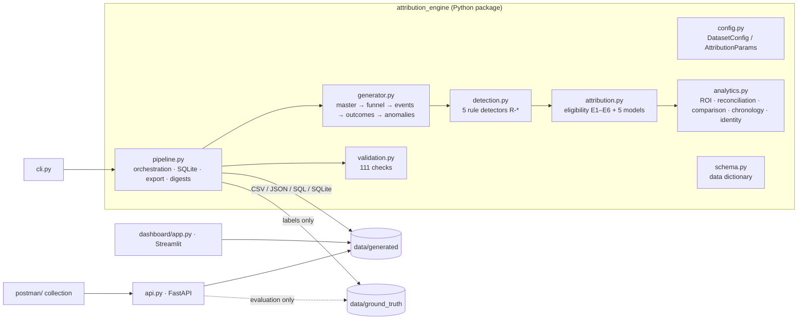
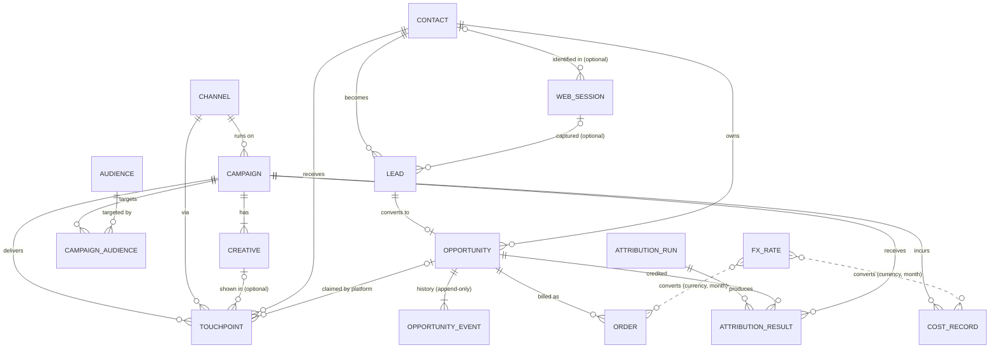
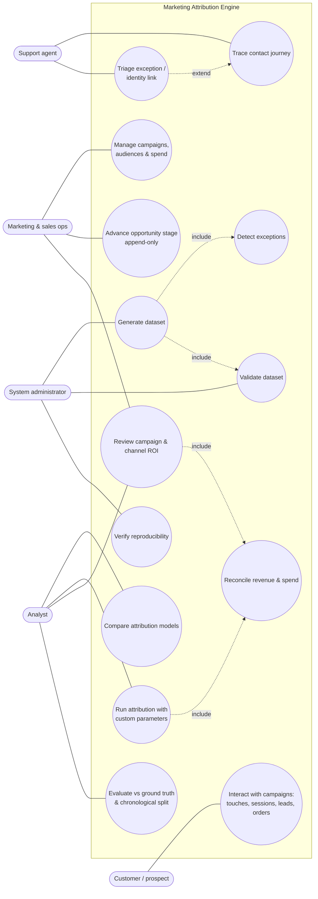
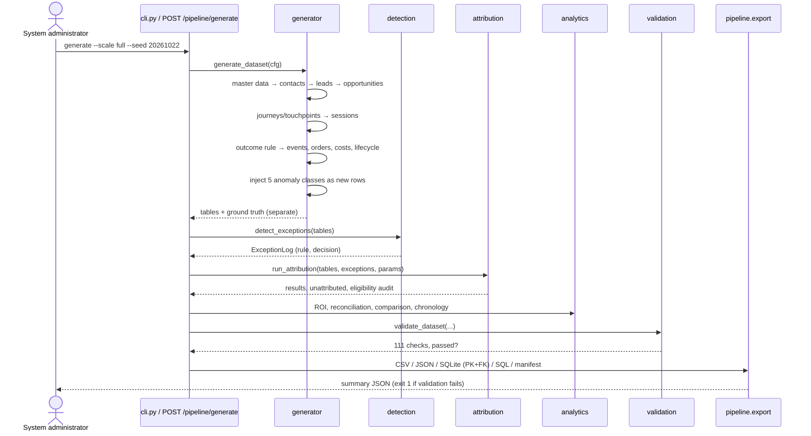
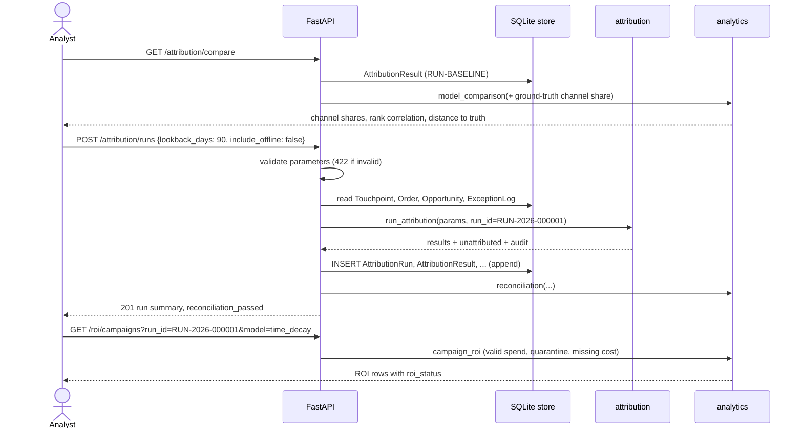
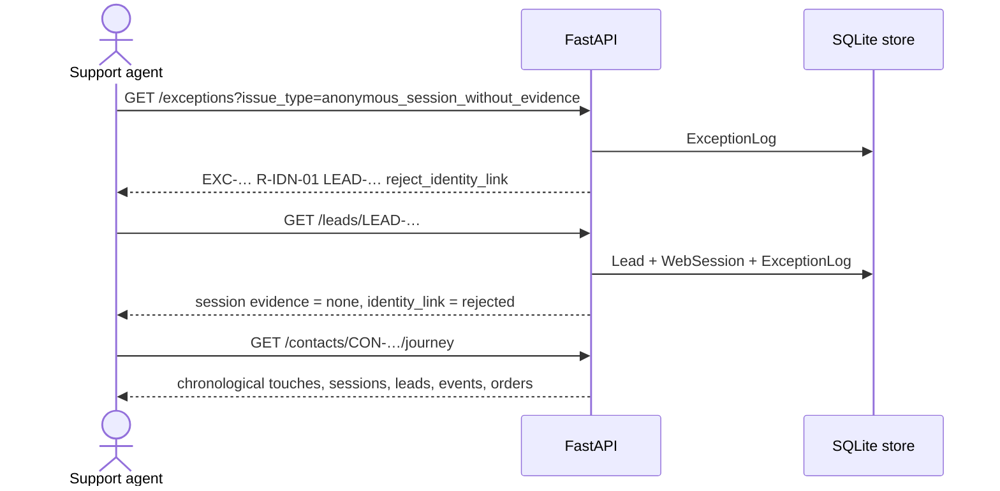
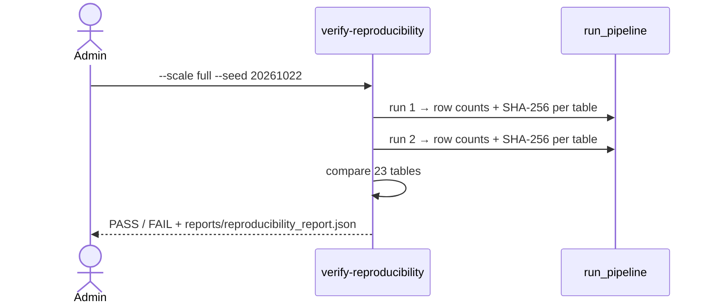

# Architecture, use cases and sequence diagrams

The diagrams are Mermaid, so they render on GitHub, in VS Code (with a Mermaid extension) and at mermaid.live.

## 1. Components



**Design choices**

* **Labels never touch the engine.** Input tables contain no `issue_type`. The engine finds exceptions with rules (`detection.py`), and ground truth is read only by evaluation code.
* **Derived values are computed, not generated.** Contact `created_at` and `lifecycle_state`, lead `status`, opportunity stage and outcome, `is_offline`, cost amounts, order revenue, credit and ROI are all calculated from source records.
* **History is append-only.** Opportunity stage changes are events. The current stage is a SQL view, and attribution runs are new rows keyed by `run_id`.
* **Money is conserved.** Credit is split in integer cents, and reconciliation proves gross = duplicates + attributed + unattributed for every currency and model.
* **The same generator serves both scales.** `DatasetConfig.starter()` and `DatasetConfig()` differ only in volumes, and the seed drives a single `numpy.random.Generator`.

## 2. Entity-relationship diagram



Cardinality summary: Channel 1:N Campaign; Campaign 1:N Creative; Campaign **N:M** Audience through the `CampaignAudience` bridge (with effective dates); Contact 1:N Touchpoint / Lead / Opportunity; Contact 0..1:N WebSession (anonymous sessions have no contact); WebSession 0..1:N Lead (offline leads have no session); Lead 1:0..1 Opportunity; Opportunity 1:N OpportunityEvent; Opportunity 1:0..N Order (more than one valid order is an exception); AttributionRun 1:N AttributionResult.

## 3. Actors and use cases

| Actor | Goals | Main entry points |
|---|---|---|
| Customer / prospect | Generates the behaviour being measured: touches, sessions, form fills, purchases | Synthetic: `generator.py` |
| Marketing & sales operations | Manage campaigns and audiences, move deals through stages, check spend | `/campaigns`, `/opportunities/{id}/events`, `/cost-records` |
| Support agent | Investigate a contact's journey, a rejected identity link or a duplicate invoice | `/contacts/{id}/journey`, `/leads/{id}`, `/exceptions/{id}` |
| Analyst | Compare models, read ROI, rerun with other parameters, evaluate against ground truth | `/attribution/*`, `/roi/*`, `/evaluation/*`, dashboard |
| System administrator | Generate and regenerate data, validate, prove reproducibility, check health | CLI, `/pipeline/*`, `/health`, Docker |



## 4. Sequence diagrams

### 4.1 Generate a dataset (administrator)



### 4.2 Compare models and rerun with new parameters (analyst)



### 4.3 Advance an opportunity stage (sales operations)

```mermaid
sequenceDiagram
  actor Ops as Sales ops
  participant API as FastAPI
  participant V as opportunity_current_stage (view)
  participant E as OpportunityEvent (append-only)
  Ops->>API: POST /opportunities/OPP-…/events {to_stage: proposal}
  API->>V: current stage, last event time, count
  alt transition not allowed
    API-->>Ops: 409 invalid_transition (allowed list)
  else event older than last event
    API-->>Ops: 422 out_of_order_event
  else valid
    API->>E: INSERT event (sequence n+1)
    API->>V: re-read current stage
    API-->>Ops: 201 appended + current stage
  end
  Note over API,E: Opportunity.stage snapshot is never updated;<br/>revenue only comes from Order records.
```

### 4.4 Investigate an exception (support agent)



### 4.5 Prove reproducibility (administrator)



## 5. Production-hardening notes

This is a synthetic prototype. A production version would add timezone-aware timestamps, a governed FX source, consent enforcement before attribution, authentication and role-based access on the API (the write endpoints are currently open), a server database such as PostgreSQL, incremental or streaming processing, and data-driven models (Markov or Shapley) alongside the rule-based ones.
